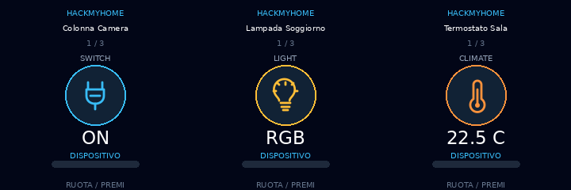

# HMH Universal Knob

**Un controller universale per Home Assistant sullo smart knob OpenNextion Genius ONX2424G013.**



Firmware **ESPHome + LVGL** per il dispositivo **OpenNextion Genius Series 1,28" (ESP32-S3, 240×240 px, encoder rotativo con pressione)**. Le pagine vengono costruite dinamicamente a partire dall'etichetta Home Assistant **`HMH_Device`**: aggiungi un'entità o un dispositivo all'etichetta senza modificare la configurazione firmware per ogni nuova pagina.

> **Versione:** v0.1.3 · Progetto sperimentale. I test offline sono stati eseguiti; la compilazione ESPHome completa non è stata rieseguita nella preparazione di questa pubblicazione. Prima di installarlo sul tuo dispositivo, usa **Validate** e verifica i permessi HA. Il flash sostituisce il firmware presente sul Knob.

## Funzionalità

- **Scoperta dinamica:** fino a 24 pagine con `HMH_Device` applicata a singole entità o dispositivi fisici.
- **Una pagina per dispositivo fisico:** scelta del controllo principale; le letture elettriche dello stesso device sono mostrate come telemetria.
- **Interfaccia adattiva:** `light`, `switch`, `input_boolean`, `climate`, `cover`, `fan`, `media_player`, `scene`, `script` e `sensor`.
- **Manopola rotativa + pressione:** scorrimento, scelta delle funzioni e conferma esplicita dei comandi.
- **Sicurezza delle modifiche:** ruotare non invia comandi; le modifiche non confermate vengono annullate automaticamente.
- **Encoder più controllabile:** filtro 180 ms e ritorno alla navigazione dopo 6,5 secondi di inattività, entrambi configurabili.
- **Niente token REST sul Knob:** comunicazione via API ESPHome cifrata; comandi mediati da tre script Home Assistant.

## Avvio rapido

1. [Leggi la guida di installazione](docs/INSTALLAZIONE.md) e salva una copia del firmware esistente prima di sostituirlo.
2. Crea l'etichetta **`HMH_Device`** in Home Assistant e applicala a un'entità o dispositivo da controllare.
3. Aggiungi le definizioni in [`ha/hmh_knob_scripts.yaml`](ha/hmh_knob_scripts.yaml) al tuo `scripts.yaml`, poi ricarica gli script.
4. Copia nella cartella ESPHome i sorgenti in [`esphome/`](esphome/), **incluse tutte le nove icone** in `esphome/icons/`.
5. Prepara le voci `wifi_ssid`, `wifi_password` e `api_encryption_key` nel tuo **`/config/esphome/secrets.yaml`** (vedi [`secrets.yaml.example`](esphome/secrets.yaml.example)). Il file reale dei segreti non va pubblicato.
6. In ESPHome **Validate → Install**; in Home Assistant abilita per il nuovo dispositivo l'autorizzazione a eseguire azioni Home Assistant.

**Guide:** [Installazione](docs/INSTALLAZIONE.md) · [Utilizzo e controlli](docs/UTILIZZO.md) · [Problemi comuni](docs/FAQ.md) · [Note di rilascio](CHANGELOG.md) · [Dettagli v0.1.3](README_IT.md)

## Struttura del progetto

```text
esphome/
  hmh_universal_knob.yaml   # configurazione ESPHome
  hmh_universal_knob.h      # modello, parser JSON, stato UI, LVGL
  icons/                   # 9 icone PNG per dominio
  secrets.yaml.example     # solo nomi di chiavi, nessun segreto reale
ha/
  hmh_knob_scripts.yaml    # catalogo, stato e comando HA
docs/
  INSTALLAZIONE.md         # guida passo-passo
  UTILIZZO.md              # controlli e funzionalità
  FAQ.md                   # diagnosi e problemi frequenti
tools/
  Update-HMH-Knob.ps1      # aggiornamento sorgenti via SCP (Windows)
tests/
  test_bridge_templates.py # test template Jinja con fixture
  test_encoder_timeout.cpp # test stato encoder e timeout
```

## Hardware

| Caratteristica | Specifica |
| --- | --- |
| Modello | OpenNextion Genius ONX2424G013 |
| Microcontrollore | ESP32-S3, 16 MB Flash / 8 MB PSRAM |
| Display | IPS circolare da 1,28", 240×240 px; GC9A01A |
| Comandi | Encoder rotativo e pressione, **senza touch** |
| Collegamenti | Wi-Fi, BLE a livello hardware, USB-C, GPIO/UART |

**Prodotto ITEAD:** [OpenNextion Genius 1,28"](https://itead.cc/product/open-nextion-genius-series-1-28-esp32-s3-smart-knob-screen/ref/398/) (link affiliato HackMyHome: eventuali acquisti tramite questo URL possono supportare il canale).

## Test

I test presenti nel pacchetto verificano i template Home Assistant con dispositivi simulati e la macchina a stati della manopola. Non sostituiscono una build ESPHome sul tuo ambiente né un test di funzionamento con i tuoi dispositivi.

```bash
python -m pip install pyyaml jinja2
python tests/test_bridge_templates.py
g++ -std=c++17 -Itests/stubs tests/test_encoder_timeout.cpp -o /tmp/hmh_knob_test
/tmp/hmh_knob_test
```

**HackMyHome** · [Canale YouTube](https://www.youtube.com/@HMH-Aura-Nova)

*Nota sulla licenza:* il progetto è pubblicato per consultazione e sperimentazione; non è ancora stata specificata una licenza di riutilizzo. La scelta della licenza spetta all'autore.

## Pubblicazione del repository (Windows)

Per creare un repository GitHub dedicato usando un PC Windows: installa **Git** e **GitHub CLI**, esegui `gh auth login`, poi lancia `tools/Publish-HMH-Universal-Knob.ps1` dalla cartella estratta. Lo script richiede una conferma esplicita prima di effettuare il push e non pubblica `secrets.yaml`. Vedi la [guida di pubblicazione](docs/PUBBLICAZIONE_GITHUB.md).
